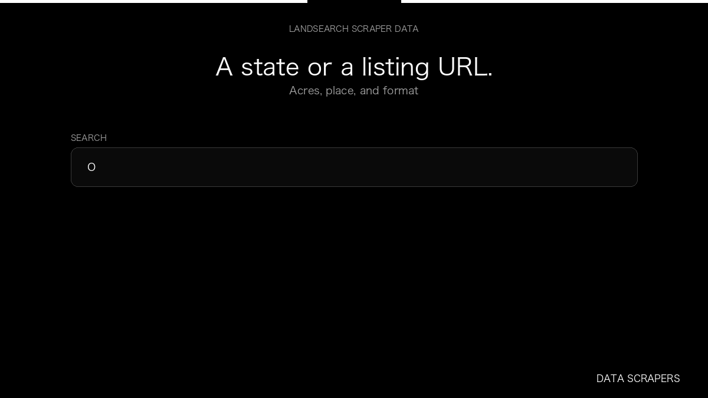

# LandSearch Scraper

**LandSearch Scraper** is an Apify Actor by Data Scrapers for LandSearch data.

This folder hosts the public demo GIF used on the Actor README. The scraper itself runs on Apify Store — not in this repository.

**[LandSearch Scraper on Apify](https://apify.com/datascrapers/landsearch-scraper)**

## What this LandSearch scraper does

LandSearch parcels with place, acreage, sale format, and state.

Use it as a LandSearch scraper to extract structured data and export CSV, JSON, Excel, or XML from Apify.

## Start here

1. Open [LandSearch Scraper](https://apify.com/datascrapers/landsearch-scraper) on Apify Store.
2. Paste your LandSearch URLs, queries, or other documented inputs.
3. Click **Start** and export JSON, CSV, Excel, or XML.

If you found this GitHub page while looking for a LandSearch scraper, use the Apify link above to run it.
