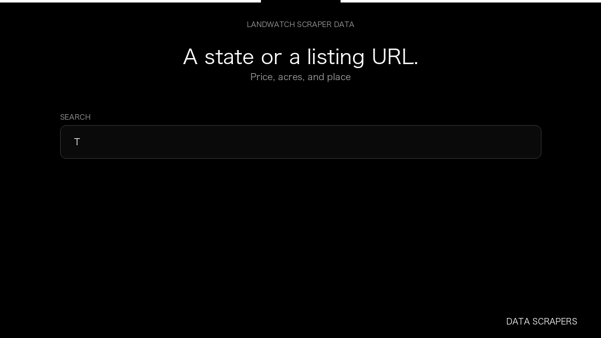

# LandWatch Scraper

**LandWatch Scraper** is an Apify Actor by Data Scrapers for LandWatch data.

This folder hosts the public demo GIF used on the Actor README. The scraper itself runs on Apify Store — not in this repository.

**[LandWatch Scraper on Apify](https://apify.com/datascrapers/landwatch-scraper)**

## What this LandWatch scraper does

LandWatch land listings with place, acreage, price, and state.

Use it as a LandWatch scraper to extract structured data and export CSV, JSON, Excel, or XML from Apify.

## Start here

1. Open [LandWatch Scraper](https://apify.com/datascrapers/landwatch-scraper) on Apify Store.
2. Paste your LandWatch URLs, queries, or other documented inputs.
3. Click **Start** and export JSON, CSV, Excel, or XML.

If you found this GitHub page while looking for a LandWatch scraper, use the Apify link above to run it.
