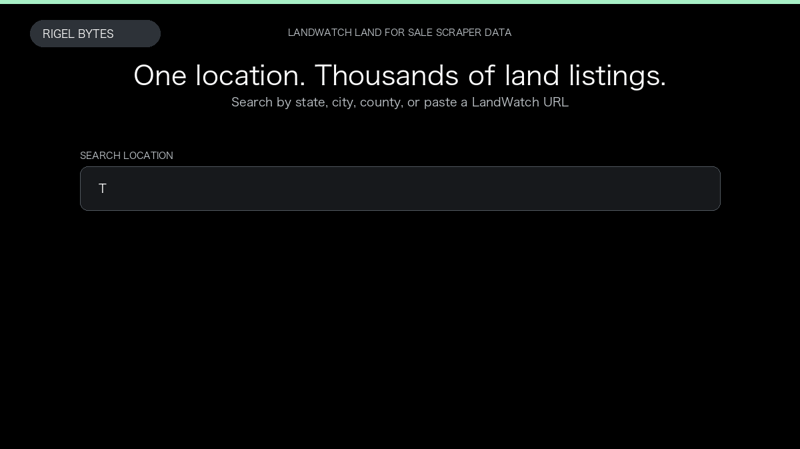

# LandWatch Land for Sale Scraper

**LandWatch Land for Sale Scraper** is an Apify Actor by Rigel Bytes for LandWatch data.

This folder hosts the public demo GIF used on the Actor README. The scraper itself runs on Apify Store — not in this repository.

**[LandWatch Land for Sale Scraper on Apify](https://apify.com/rigelbytes/landwatch-scraper)**

## What this LandWatch scraper does

Scrape LandWatch land listings by location or URL. Export price, acreage, broker data, and optional listing details and seller profiles.

Use it as a LandWatch scraper to extract structured data and export CSV, JSON, Excel, or XML from Apify.

## Start here

1. Open [LandWatch Land for Sale Scraper](https://apify.com/rigelbytes/landwatch-scraper) on Apify Store.
2. Paste your LandWatch URLs, queries, or other documented inputs.
3. Click **Start** and export JSON, CSV, Excel, or XML.

If you found this GitHub page while looking for a LandWatch scraper, use the Apify link above to run it.
