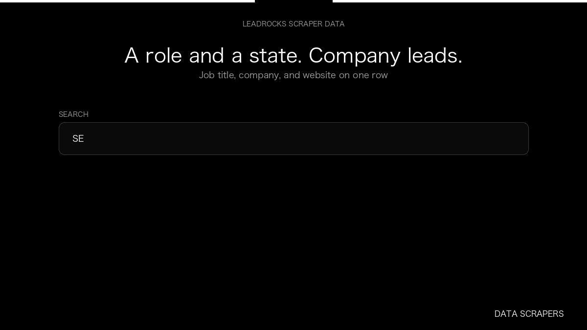

# LeadRocks Scraper

**LeadRocks Scraper** is an Apify Actor by Data Scrapers for LeadRocks data.

This folder hosts the public demo GIF used on the Actor README. The scraper itself runs on Apify Store — not in this repository.

**[LeadRocks Scraper on Apify](https://apify.com/datascrapers/leadrocks-scraper)**

## What this LeadRocks scraper does

Collect professional leads from LeadRocks with job title, company, and location.

Use it as a LeadRocks scraper to extract structured data and export CSV, JSON, Excel, or XML from Apify.

## Start here

1. Open [LeadRocks Scraper](https://apify.com/datascrapers/leadrocks-scraper) on Apify Store.
2. Paste your LeadRocks URLs, queries, or other documented inputs.
3. Click **Start** and export JSON, CSV, Excel, or XML.

If you found this GitHub page while looking for a LeadRocks scraper, use the Apify link above to run it.
