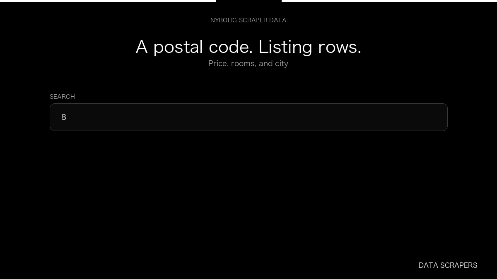

# Nybolig Scraper

**Nybolig Scraper** is an Apify Actor by Data Scrapers for Nybolig data.

This folder hosts the public demo GIF used on the Actor README. The scraper itself runs on Apify Store — not in this repository.

**[Nybolig Scraper on Apify](https://apify.com/datascrapers/nybolig-dk-scraper)**

## What this Nybolig scraper does

Nybolig listings with address, city, asking price, and room count.

Use it as a Nybolig scraper to extract structured data and export CSV, JSON, Excel, or XML from Apify.

## Start here

1. Open [Nybolig Scraper](https://apify.com/datascrapers/nybolig-dk-scraper) on Apify Store.
2. Paste your Nybolig URLs, queries, or other documented inputs.
3. Click **Start** and export JSON, CSV, Excel, or XML.

If you found this GitHub page while looking for a Nybolig scraper, use the Apify link above to run it.
