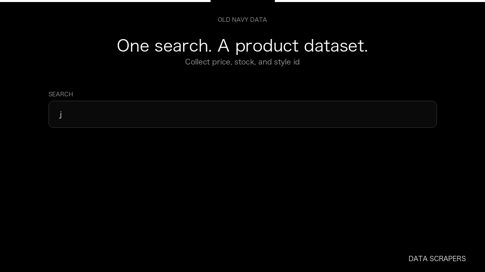

# Old Navy Scraper

**Old Navy Scraper** is an Apify Actor by Data Scrapers for Old Navy data.

This folder hosts the public demo GIF used on the Actor README. The scraper itself runs on Apify Store — not in this repository.

**[Old Navy Scraper on Apify](https://apify.com/datascrapers/oldnavy-gap-scraper)**

## What this Old Navy scraper does

Collect Old Navy products as a dataset, with price, stock, and style id.

Use it as a Old Navy scraper to extract structured data and export CSV, JSON, Excel, or XML from Apify.

## Start here

1. Open [Old Navy Scraper](https://apify.com/datascrapers/oldnavy-gap-scraper) on Apify Store.
2. Paste your Old Navy URLs, queries, or other documented inputs.
3. Click **Start** and export JSON, CSV, Excel, or XML.

If you found this GitHub page while looking for a Old Navy scraper, use the Apify link above to run it.
