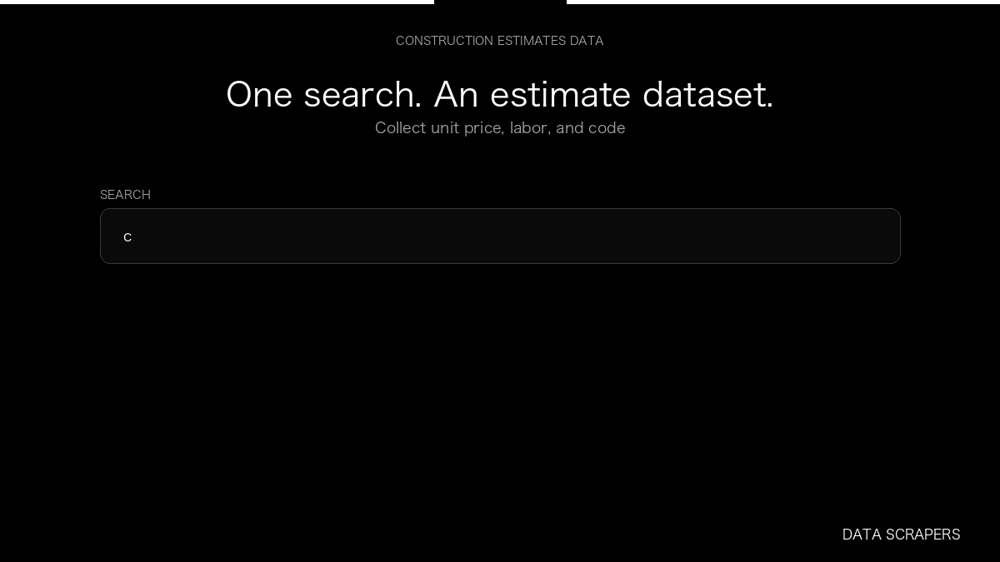

# Open Construction Estimate Scraper

**Open Construction Estimate Scraper** is an Apify Actor by Data Scrapers for Open Construction Estimate data.

This folder hosts the public demo GIF used on the Actor README. The scraper itself runs on Apify Store — not in this repository.

**[Open Construction Estimate Scraper on Apify](https://apify.com/datascrapers/openconstructionestimate-scraper)**

## What this Open Construction Estimate scraper does

Collect construction unit estimates as a dataset, with price, unit, and labor hours.

Use it as a Open Construction Estimate scraper to extract structured data and export CSV, JSON, Excel, or XML from Apify.

## Start here

1. Open [Open Construction Estimate Scraper](https://apify.com/datascrapers/openconstructionestimate-scraper) on Apify Store.
2. Paste your Open Construction Estimate URLs, queries, or other documented inputs.
3. Click **Start** and export JSON, CSV, Excel, or XML.

If you found this GitHub page while looking for a Open Construction Estimate scraper, use the Apify link above to run it.
