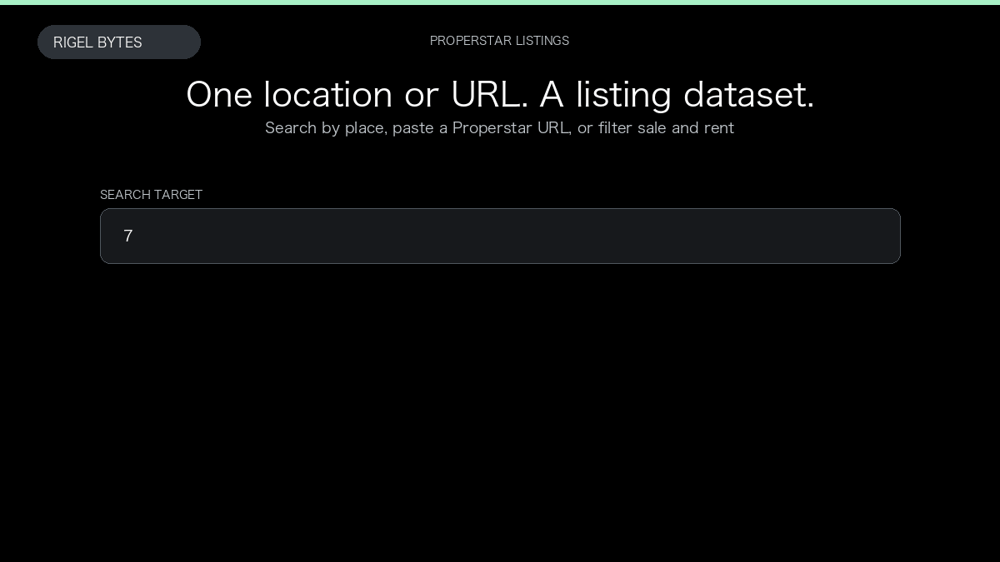

# Properstar Real Estate Scraper

**Properstar Real Estate Scraper** is an Apify Actor by Rigel Bytes for Properstar data.

This folder hosts the public demo GIF used on the Actor README. The scraper itself runs on Apify Store — not in this repository.

**[Properstar Real Estate Scraper on Apify](https://apify.com/rigelbytes/properstar-scraper)**

## What this Properstar scraper does

Scrape Properstar listings by location or URL into structured property records with optional listing details, agent profiles, and agency data.

Use it as a Properstar scraper to extract structured data and export CSV, JSON, Excel, or XML from Apify.

## Start here

1. Open [Properstar Real Estate Scraper](https://apify.com/rigelbytes/properstar-scraper) on Apify Store.
2. Paste your Properstar URLs, queries, or other documented inputs.
3. Click **Start** and export JSON, CSV, Excel, or XML.

If you found this GitHub page while looking for a Properstar scraper, use the Apify link above to run it.
