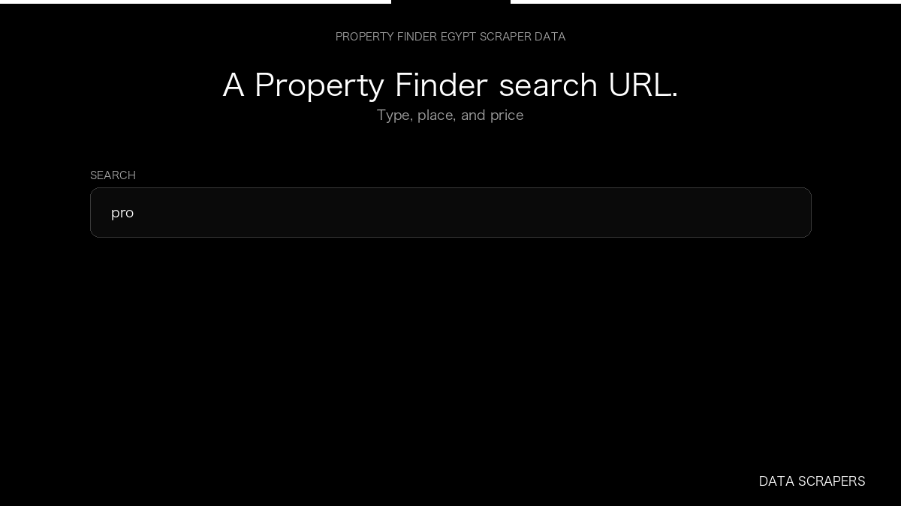

# Property Finder Egypt Scraper

**Property Finder Egypt Scraper** is an Apify Actor by Data Scrapers for Property Finder data.

This folder hosts the public demo GIF used on the Actor README. The scraper itself runs on Apify Store — not in this repository.

**[Property Finder Egypt Scraper on Apify](https://apify.com/datascrapers/propertyfinder-eygpt)**

## What this Property Finder scraper does

Property Finder Egypt listings with place, type, price, and currency.

Use it as a Property Finder scraper to extract structured data and export CSV, JSON, Excel, or XML from Apify.

## Start here

1. Open [Property Finder Egypt Scraper](https://apify.com/datascrapers/propertyfinder-eygpt) on Apify Store.
2. Paste your Property Finder URLs, queries, or other documented inputs.
3. Click **Start** and export JSON, CSV, Excel, or XML.

If you found this GitHub page while looking for a Property Finder scraper, use the Apify link above to run it.
