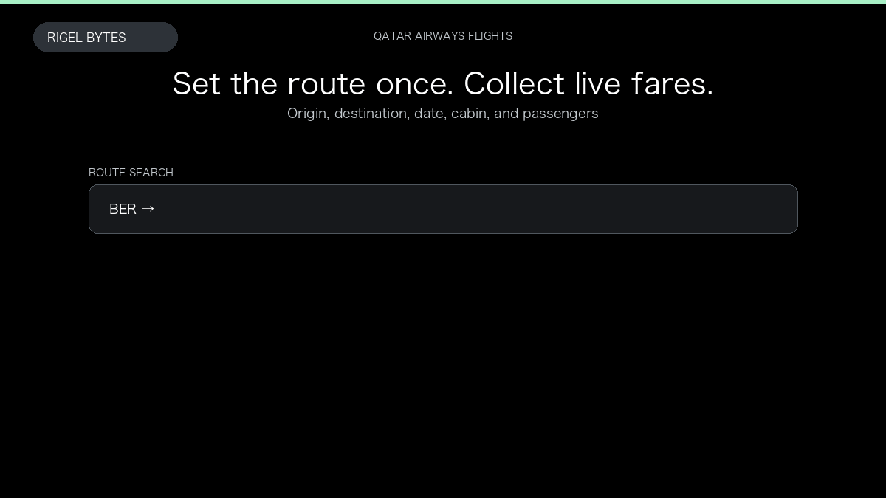

# Qatar Airways Flight Scraper

**Qatar Airways Flight Scraper** is an Apify Actor by Rigel Bytes for Qatar Airways data.

This folder hosts the public demo GIF used on the Actor README. The scraper itself runs on Apify Store — not in this repository.

**[Qatar Airways Flight Scraper on Apify](https://apify.com/rigelbytes/qatarairways-scraper)**

## What this Qatar Airways scraper does

Search live Qatar Airways fares for one-way, round-trip, and multi-city routes. Export flight offers with prices, segments, fare families, and flexible-date calendar lows as JSON or CSV.

Use it as a Qatar Airways scraper to extract structured data and export CSV, JSON, Excel, or XML from Apify.

## Start here

1. Open [Qatar Airways Flight Scraper](https://apify.com/rigelbytes/qatarairways-scraper) on Apify Store.
2. Paste your Qatar Airways URLs, queries, or other documented inputs.
3. Click **Start** and export JSON, CSV, Excel, or XML.

If you found this GitHub page while looking for a Qatar Airways scraper, use the Apify link above to run it.
