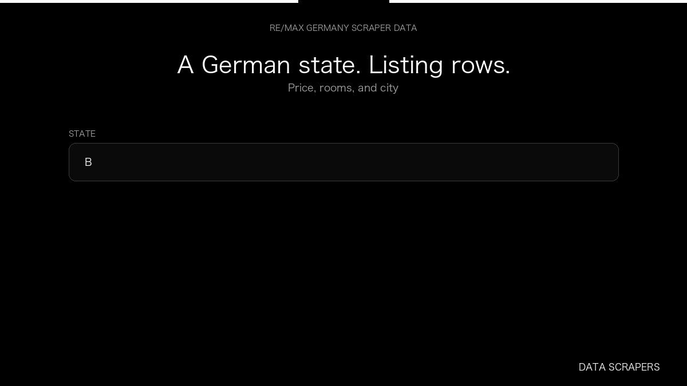

# RE/MAX Germany Scraper

**RE/MAX Germany Scraper** is an Apify Actor by Data Scrapers for RE/MAX Germany data.

This folder hosts the public demo GIF used on the Actor README. The scraper itself runs on Apify Store — not in this repository.

**[RE/MAX Germany Scraper on Apify](https://apify.com/datascrapers/remax-scraper)**

## What this RE/MAX Germany scraper does

Collect RE/MAX Germany listings with price, rooms, and city.

Use it as a RE/MAX Germany scraper to extract structured data and export CSV, JSON, Excel, or XML from Apify.

## Start here

1. Open [RE/MAX Germany Scraper](https://apify.com/datascrapers/remax-scraper) on Apify Store.
2. Paste your RE/MAX Germany URLs, queries, or other documented inputs.
3. Click **Start** and export JSON, CSV, Excel, or XML.

If you found this GitHub page while looking for a RE/MAX Germany scraper, use the Apify link above to run it.
