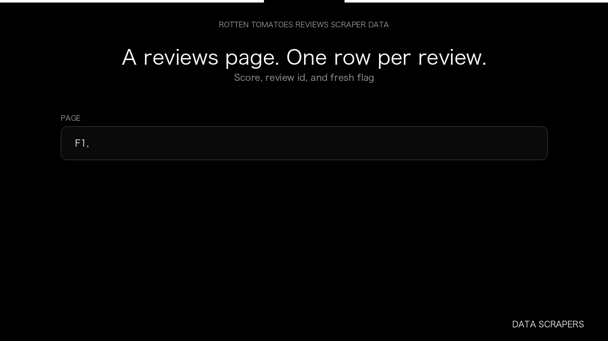

# Rotten Tomatoes Reviews Scraper

**Rotten Tomatoes Reviews Scraper** is an Apify Actor by Data Scrapers for Rotten Tomatoes data.

This folder hosts the public demo GIF used on the Actor README. The scraper itself runs on Apify Store — not in this repository.

**[Rotten Tomatoes Reviews Scraper on Apify](https://apify.com/datascrapers/rottentomatoes-reviews-scraper)**

## What this Rotten Tomatoes scraper does

Collect Rotten Tomatoes reviews with score, review id, and fresh flags.

Use it as a Rotten Tomatoes scraper to extract structured data and export CSV, JSON, Excel, or XML from Apify.

## Start here

1. Open [Rotten Tomatoes Reviews Scraper](https://apify.com/datascrapers/rottentomatoes-reviews-scraper) on Apify Store.
2. Paste your Rotten Tomatoes URLs, queries, or other documented inputs.
3. Click **Start** and export JSON, CSV, Excel, or XML.

If you found this GitHub page while looking for a Rotten Tomatoes scraper, use the Apify link above to run it.
