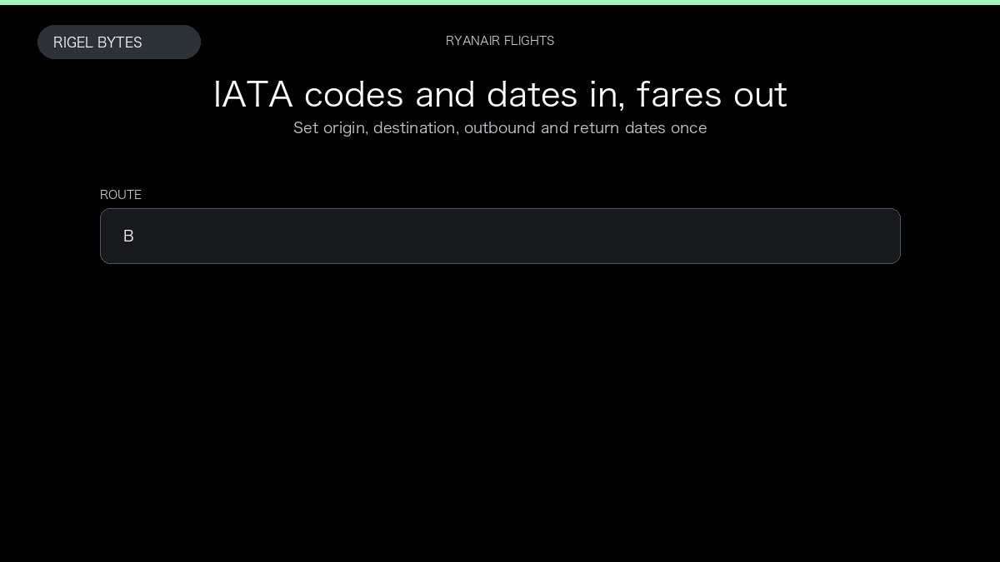

# Ryanair Flight Availability Scraper

**Ryanair Flight Availability Scraper** is an Apify Actor by Rigel Bytes for Ryanair data.

This folder hosts the public demo GIF used on the Actor README. The scraper itself runs on Apify Store — not in this repository.

**[Ryanair Flight Availability Scraper on Apify](https://apify.com/rigelbytes/ryanair-scraper)**

## What this Ryanair scraper does

Scrape Ryanair flight availability, priced fares, and calendar dates for origin/destination routes. Pass IATA codes and travel dates and export structured flight records for monitoring and automation.

Use it as a Ryanair scraper to extract structured data and export CSV, JSON, Excel, or XML from Apify.

## Start here

1. Open [Ryanair Flight Availability Scraper](https://apify.com/rigelbytes/ryanair-scraper) on Apify Store.
2. Paste your Ryanair URLs, queries, or other documented inputs.
3. Click **Start** and export JSON, CSV, Excel, or XML.

If you found this GitHub page while looking for a Ryanair scraper, use the Apify link above to run it.
