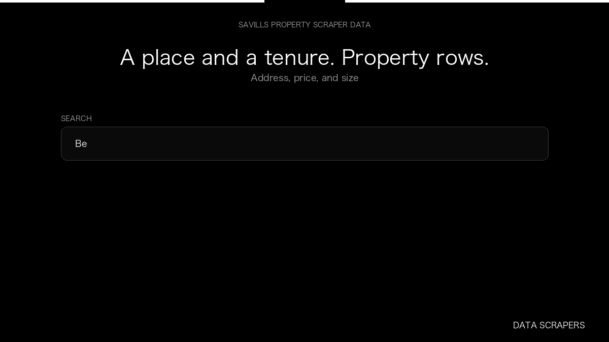

# Savills Property Scraper

**Savills Property Scraper** is an Apify Actor by Data Scrapers for Savills data.

This folder hosts the public demo GIF used on the Actor README. The scraper itself runs on Apify Store — not in this repository.

**[Savills Property Scraper on Apify](https://apify.com/datascrapers/savills-scraper)**

## What this Savills scraper does

Collect Savills property listings with address, price, and size.

Use it as a Savills scraper to extract structured data and export CSV, JSON, Excel, or XML from Apify.

## Start here

1. Open [Savills Property Scraper](https://apify.com/datascrapers/savills-scraper) on Apify Store.
2. Paste your Savills URLs, queries, or other documented inputs.
3. Click **Start** and export JSON, CSV, Excel, or XML.

If you found this GitHub page while looking for a Savills scraper, use the Apify link above to run it.
