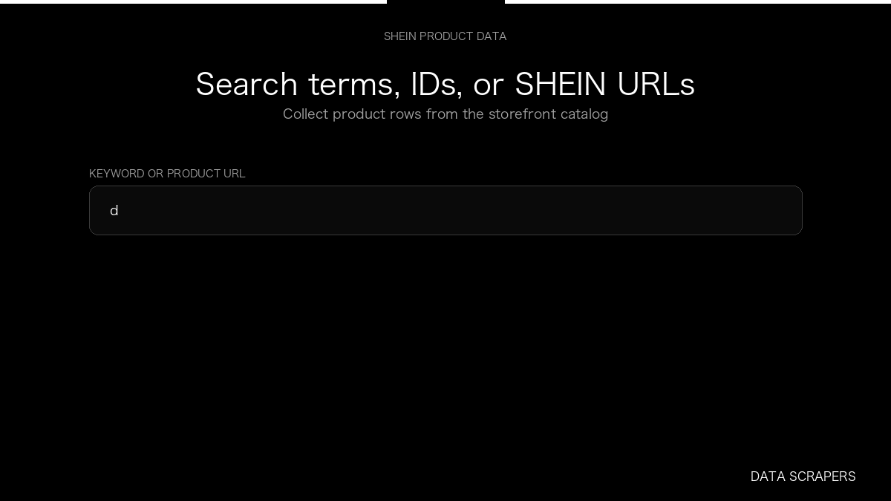

# SHEIN Scraper

**SHEIN Scraper** is an Apify Actor by Data Scrapers for SHEIN data.

This folder hosts the public demo GIF used on the Actor README. The scraper itself runs on Apify Store — not in this repository.

**[SHEIN Scraper on Apify](https://apify.com/datascrapers/shein-scraper)**

## What this SHEIN scraper does

Structured SHEIN product listings with optional size details and customer reviews.

Use it as a SHEIN scraper to extract structured data and export CSV, JSON, Excel, or XML from Apify.

## Start here

1. Open [SHEIN Scraper](https://apify.com/datascrapers/shein-scraper) on Apify Store.
2. Paste your SHEIN URLs, queries, or other documented inputs.
3. Click **Start** and export JSON, CSV, Excel, or XML.

If you found this GitHub page while looking for a SHEIN scraper, use the Apify link above to run it.
