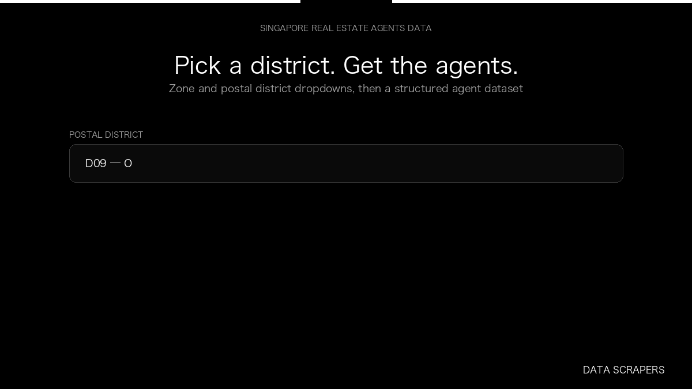

# Singapore Real Estate Agents

**Singapore Real Estate Agents** is an Apify Actor by Data Scrapers for 99.co data.

This folder hosts the public demo GIF used on the Actor README. The scraper itself runs on Apify Store — not in this repository.

**[Singapore Real Estate Agents on Apify](https://apify.com/datascrapers/singapore-realestate-agents)**

## What this 99.co scraper does

Structured Singapore real estate agent records from 99.co, queried by planning zone or postal district, with optional phone numbers and deal history.

Use it as a 99.co scraper to extract structured data and export CSV, JSON, Excel, or XML from Apify.

## Start here

1. Open [Singapore Real Estate Agents](https://apify.com/datascrapers/singapore-realestate-agents) on Apify Store.
2. Paste your 99.co URLs, queries, or other documented inputs.
3. Click **Start** and export JSON, CSV, Excel, or XML.

If you found this GitHub page while looking for a 99.co scraper, use the Apify link above to run it.
