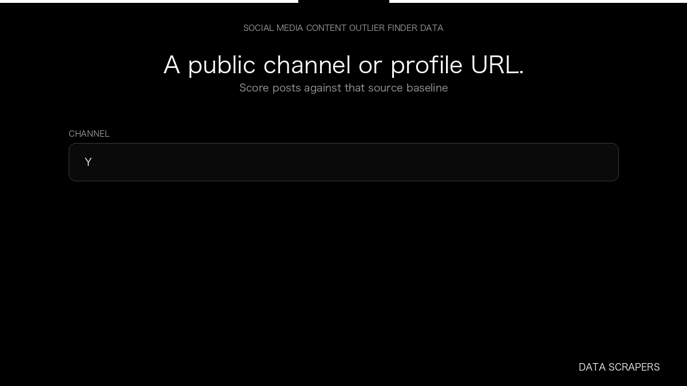

# Social Media Content Outlier Finder

**Social Media Content Outlier Finder** is an Apify Actor by Data Scrapers for YouTube data.

This folder hosts the public demo GIF used on the Actor README. The scraper itself runs on Apify Store — not in this repository.

**[Social Media Content Outlier Finder on Apify](https://apify.com/datascrapers/social-media-content-outlier)**

## What this YouTube scraper does

Score public posts against the baseline of the same channel or profile.

Use it as a YouTube scraper to extract structured data and export CSV, JSON, Excel, or XML from Apify.

## Start here

1. Open [Social Media Content Outlier Finder](https://apify.com/datascrapers/social-media-content-outlier) on Apify Store.
2. Paste your YouTube URLs, queries, or other documented inputs.
3. Click **Start** and export JSON, CSV, Excel, or XML.

If you found this GitHub page while looking for a YouTube scraper, use the Apify link above to run it.
