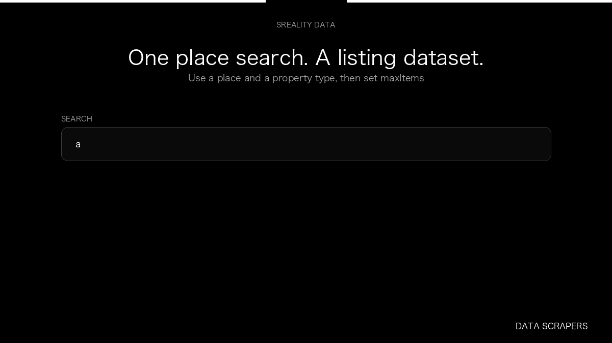

# Sreality.cz Real Estate Scraper

**Sreality.cz Real Estate Scraper** is an Apify Actor by Data Scrapers for Sreality data.

This folder hosts the public demo GIF used on the Actor README. The scraper itself runs on Apify Store — not in this repository.

**[Sreality.cz Real Estate Scraper on Apify](https://apify.com/datascrapers/sreality-scraper)**

## What this Sreality scraper does

Collect Sreality property listings as a dataset, with price, type, and listing id.

Use it as a Sreality scraper to extract structured data and export CSV, JSON, Excel, or XML from Apify.

## Start here

1. Open [Sreality.cz Real Estate Scraper](https://apify.com/datascrapers/sreality-scraper) on Apify Store.
2. Paste your Sreality URLs, queries, or other documented inputs.
3. Click **Start** and export JSON, CSV, Excel, or XML.

If you found this GitHub page while looking for a Sreality scraper, use the Apify link above to run it.
