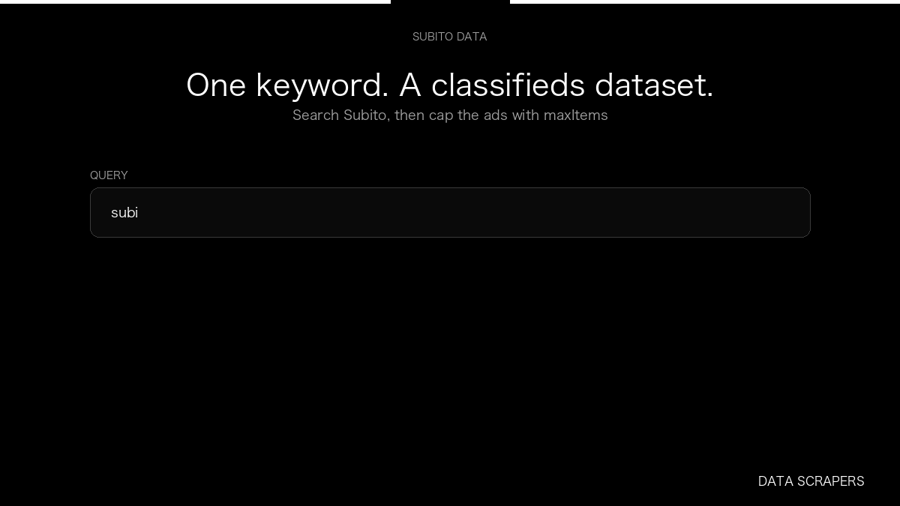

# Subito.it Scraper

**Subito.it Scraper** is an Apify Actor by Data Scrapers for Subito data.

This folder hosts the public demo GIF used on the Actor README. The scraper itself runs on Apify Store — not in this repository.

**[Subito.it Scraper on Apify](https://apify.com/datascrapers/subito-scraper)**

## What this Subito scraper does

Collect classified ads from Subito.it, including price, place, and listing id.

Use it as a Subito scraper to extract structured data and export CSV, JSON, Excel, or XML from Apify.

## Start here

1. Open [Subito.it Scraper](https://apify.com/datascrapers/subito-scraper) on Apify Store.
2. Paste your Subito URLs, queries, or other documented inputs.
3. Click **Start** and export JSON, CSV, Excel, or XML.

If you found this GitHub page while looking for a Subito scraper, use the Apify link above to run it.
