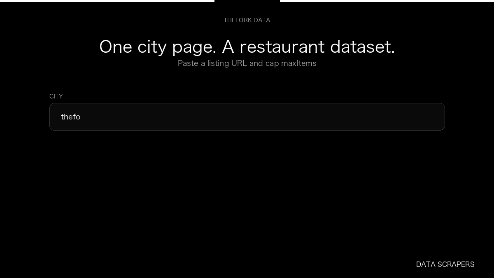

# TheFork Scraper

**TheFork Scraper** is an Apify Actor by Data Scrapers for TheFork data.

This folder hosts the public demo GIF used on the Actor README. The scraper itself runs on Apify Store — not in this repository.

**[TheFork Scraper on Apify](https://apify.com/datascrapers/thefork-scraper)**

## What this TheFork scraper does

Collect TheFork restaurants, including cuisine, rating, and restaurant id.

Use it as a TheFork scraper to extract structured data and export CSV, JSON, Excel, or XML from Apify.

## Start here

1. Open [TheFork Scraper](https://apify.com/datascrapers/thefork-scraper) on Apify Store.
2. Paste your TheFork URLs, queries, or other documented inputs.
3. Click **Start** and export JSON, CSV, Excel, or XML.

If you found this GitHub page while looking for a TheFork scraper, use the Apify link above to run it.
