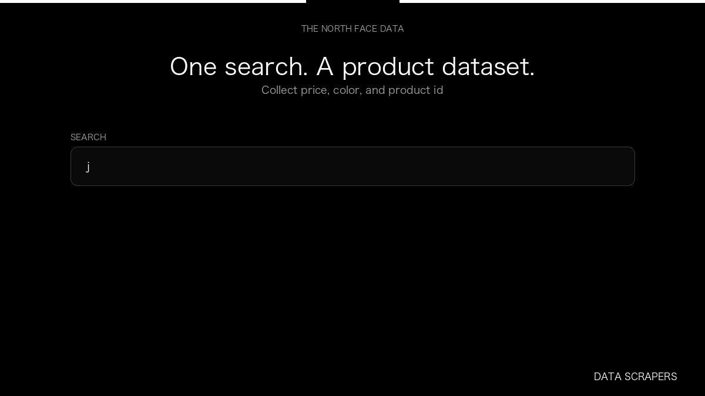

# The North Face Scraper

**The North Face Scraper** is an Apify Actor by Data Scrapers for The North Face data.

This folder hosts the public demo GIF used on the Actor README. The scraper itself runs on Apify Store — not in this repository.

**[The North Face Scraper on Apify](https://apify.com/datascrapers/thenorthface-scraper)**

## What this The North Face scraper does

Collect The North Face products as a dataset, with price, color, and product id.

Use it as a The North Face scraper to extract structured data and export CSV, JSON, Excel, or XML from Apify.

## Start here

1. Open [The North Face Scraper](https://apify.com/datascrapers/thenorthface-scraper) on Apify Store.
2. Paste your The North Face URLs, queries, or other documented inputs.
3. Click **Start** and export JSON, CSV, Excel, or XML.

If you found this GitHub page while looking for a The North Face scraper, use the Apify link above to run it.
