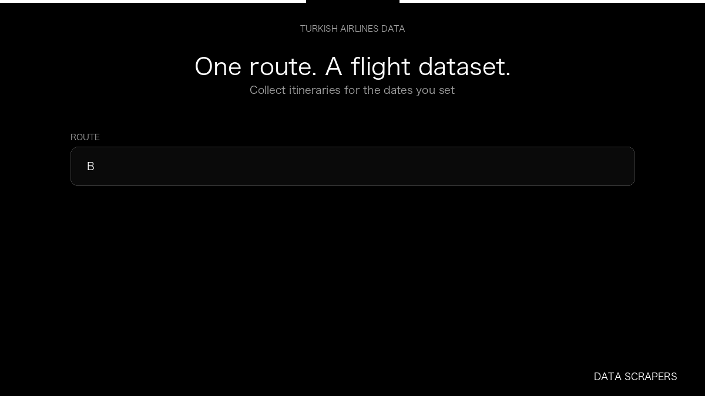

# Turkish Airlines Flight Scraper

**Turkish Airlines Flight Scraper** is an Apify Actor by Data Scrapers for Turkish Airlines data.

This folder hosts the public demo GIF used on the Actor README. The scraper itself runs on Apify Store — not in this repository.

**[Turkish Airlines Flight Scraper on Apify](https://apify.com/datascrapers/turkishairlines-scraper)**

## What this Turkish Airlines scraper does

Collect Turkish Airlines itineraries as a dataset, with route, cabin, and fare.

Use it as a Turkish Airlines scraper to extract structured data and export CSV, JSON, Excel, or XML from Apify.

## Start here

1. Open [Turkish Airlines Flight Scraper](https://apify.com/datascrapers/turkishairlines-scraper) on Apify Store.
2. Paste your Turkish Airlines URLs, queries, or other documented inputs.
3. Click **Start** and export JSON, CSV, Excel, or XML.

If you found this GitHub page while looking for a Turkish Airlines scraper, use the Apify link above to run it.
