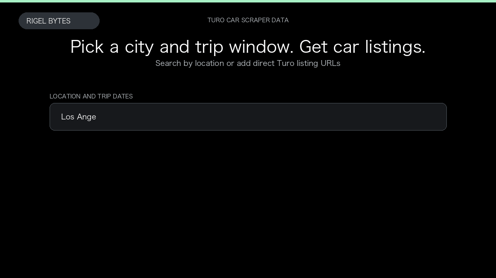

# Turo Car Scraper

**Turo Car Scraper** is an Apify Actor by Rigel Bytes for Turo data.

This folder hosts the public demo GIF used on the Actor README. The scraper itself runs on Apify Store — not in this repository.

**[Turo Car Scraper on Apify](https://apify.com/rigel-bytes/turo-car-scraper)**

## What this Turo scraper does

Extract Turo cars for a city and trip dates, with optional vehicle details, host profiles, reviews, and availability calendar.

Use it as a Turo scraper to extract structured data and export CSV, JSON, Excel, or XML from Apify.

## Start here

1. Open [Turo Car Scraper](https://apify.com/rigel-bytes/turo-car-scraper) on Apify Store.
2. Paste your Turo URLs, queries, or other documented inputs.
3. Click **Start** and export JSON, CSV, Excel, or XML.

If you found this GitHub page while looking for a Turo scraper, use the Apify link above to run it.
