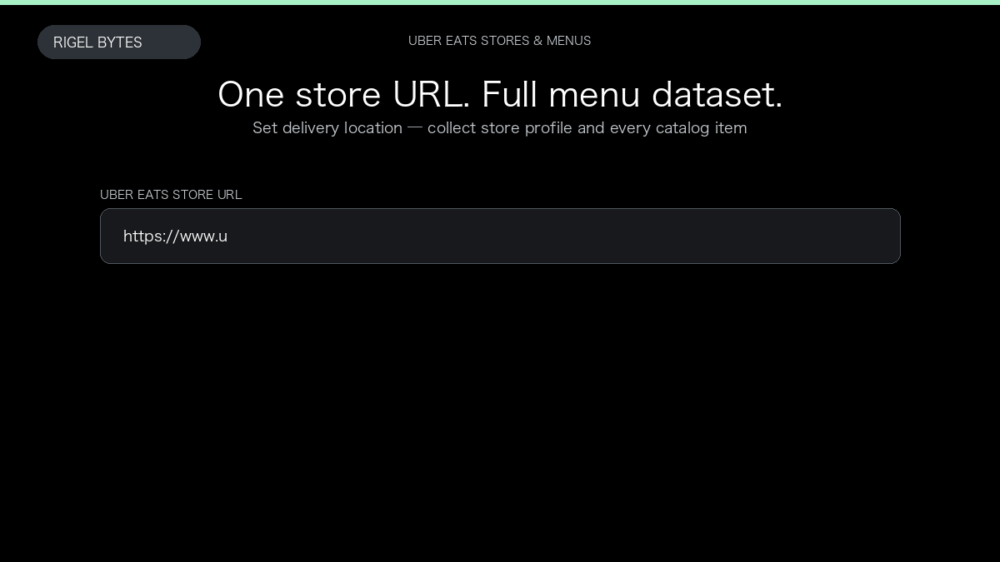

# Uber Eats Scraper

**Uber Eats Scraper** is an Apify Actor by Rigel Bytes for Uber Eats data.

This folder hosts the public demo GIF used on the Actor README. The scraper itself runs on Apify Store — not in this repository.

**[Uber Eats Scraper on Apify](https://apify.com/rigelbytes/ubereats-scraper)**

## What this Uber Eats scraper does

Scrape Uber Eats stores, full menus, and product details by location, search, or URL — export structured JSON for market research and price monitoring.

Use it as a Uber Eats scraper to extract structured data and export CSV, JSON, Excel, or XML from Apify.

## Start here

1. Open [Uber Eats Scraper](https://apify.com/rigelbytes/ubereats-scraper) on Apify Store.
2. Paste your Uber Eats URLs, queries, or other documented inputs.
3. Click **Start** and export JSON, CSV, Excel, or XML.

If you found this GitHub page while looking for a Uber Eats scraper, use the Apify link above to run it.
