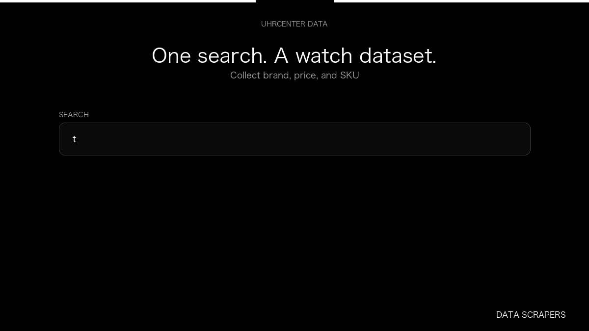

# Uhrcenter Scraper

**Uhrcenter Scraper** is an Apify Actor by Data Scrapers for Uhrcenter data.

This folder hosts the public demo GIF used on the Actor README. The scraper itself runs on Apify Store — not in this repository.

**[Uhrcenter Scraper on Apify](https://apify.com/datascrapers/uhrcenter-scraper)**

## What this Uhrcenter scraper does

Collect Uhrcenter watches as a dataset, with brand, price, and SKU.

Use it as a Uhrcenter scraper to extract structured data and export CSV, JSON, Excel, or XML from Apify.

## Start here

1. Open [Uhrcenter Scraper](https://apify.com/datascrapers/uhrcenter-scraper) on Apify Store.
2. Paste your Uhrcenter URLs, queries, or other documented inputs.
3. Click **Start** and export JSON, CSV, Excel, or XML.

If you found this GitHub page while looking for a Uhrcenter scraper, use the Apify link above to run it.
