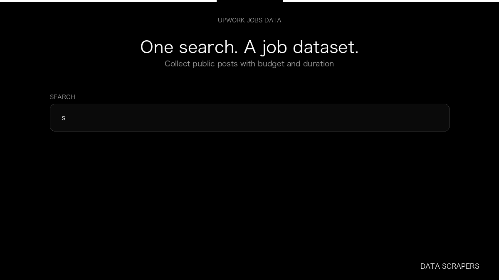

# Upwork Jobs Scraper

**Upwork Jobs Scraper** is an Apify Actor by Data Scrapers for Upwork data.

This folder hosts the public demo GIF used on the Actor README. The scraper itself runs on Apify Store — not in this repository.

**[Upwork Jobs Scraper on Apify](https://apify.com/datascrapers/upwork-jobs-scraper)**

## What this Upwork scraper does

Collect Upwork job posts as a dataset, with type, tier, and duration.

Use it as a Upwork scraper to extract structured data and export CSV, JSON, Excel, or XML from Apify.

## Start here

1. Open [Upwork Jobs Scraper](https://apify.com/datascrapers/upwork-jobs-scraper) on Apify Store.
2. Paste your Upwork URLs, queries, or other documented inputs.
3. Click **Start** and export JSON, CSV, Excel, or XML.

If you found this GitHub page while looking for a Upwork scraper, use the Apify link above to run it.
