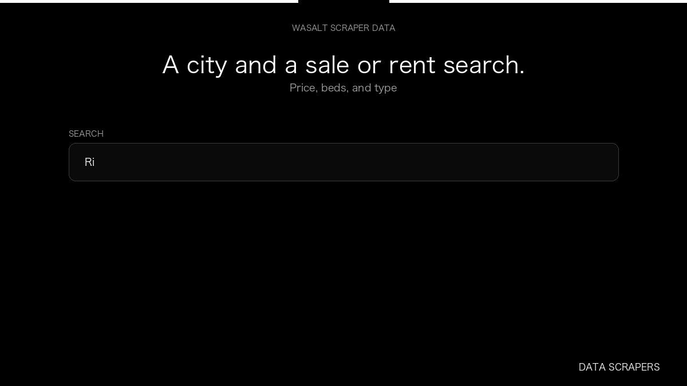

# Wasalt Scraper

**Wasalt Scraper** is an Apify Actor by Data Scrapers for Wasalt data.

This folder hosts the public demo GIF used on the Actor README. The scraper itself runs on Apify Store — not in this repository.

**[Wasalt Scraper on Apify](https://apify.com/datascrapers/wasalt-sa-scraper)**

## What this Wasalt scraper does

Wasalt listings with city, property type, price, and bedroom count.

Use it as a Wasalt scraper to extract structured data and export CSV, JSON, Excel, or XML from Apify.

## Start here

1. Open [Wasalt Scraper](https://apify.com/datascrapers/wasalt-sa-scraper) on Apify Store.
2. Paste your Wasalt URLs, queries, or other documented inputs.
3. Click **Start** and export JSON, CSV, Excel, or XML.

If you found this GitHub page while looking for a Wasalt scraper, use the Apify link above to run it.
