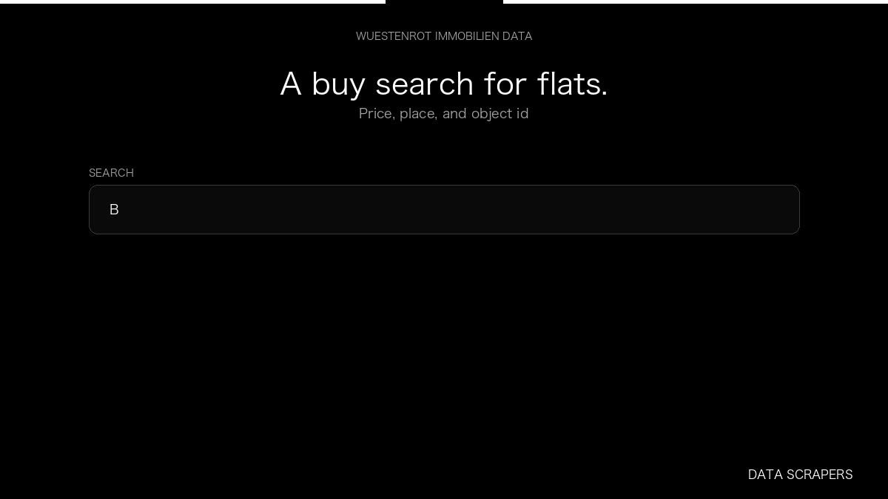

# Wuestenrot Immobilien

**Wuestenrot Immobilien** is an Apify Actor by Data Scrapers for Wuestenrot data.

This folder hosts the public demo GIF used on the Actor README. The scraper itself runs on Apify Store — not in this repository.

**[Wuestenrot Immobilien on Apify](https://apify.com/datascrapers/wuestenrot-immobilien)**

## What this Wuestenrot scraper does

Wuestenrot listings with place, asking price, object id, and type.

Use it as a Wuestenrot scraper to extract structured data and export CSV, JSON, Excel, or XML from Apify.

## Start here

1. Open [Wuestenrot Immobilien](https://apify.com/datascrapers/wuestenrot-immobilien) on Apify Store.
2. Paste your Wuestenrot URLs, queries, or other documented inputs.
3. Click **Start** and export JSON, CSV, Excel, or XML.

If you found this GitHub page while looking for a Wuestenrot scraper, use the Apify link above to run it.
