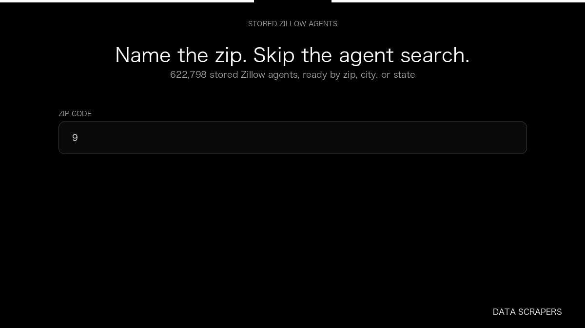

# Zillow Agents Database

**Zillow Agents Database** is an Apify Actor by Data Scrapers for Zillow data.

This folder hosts the public demo GIF used on the Actor README. The scraper itself runs on Apify Store — not in this repository.

**[Zillow Agents Database on Apify](https://apify.com/datascrapers/zillow-agents-database)**

## What this Zillow scraper does

Instant access to more than half a million Zillow real estate agents by zip code, city, or state. Export names, brokerages, ratings, sales, and optional phone and email.

Use it as a Zillow scraper to extract structured data and export CSV, JSON, Excel, or XML from Apify.

## Start here

1. Open [Zillow Agents Database](https://apify.com/datascrapers/zillow-agents-database) on Apify Store.
2. Paste your Zillow URLs, queries, or other documented inputs.
3. Click **Start** and export JSON, CSV, Excel, or XML.

If you found this GitHub page while looking for a Zillow scraper, use the Apify link above to run it.
