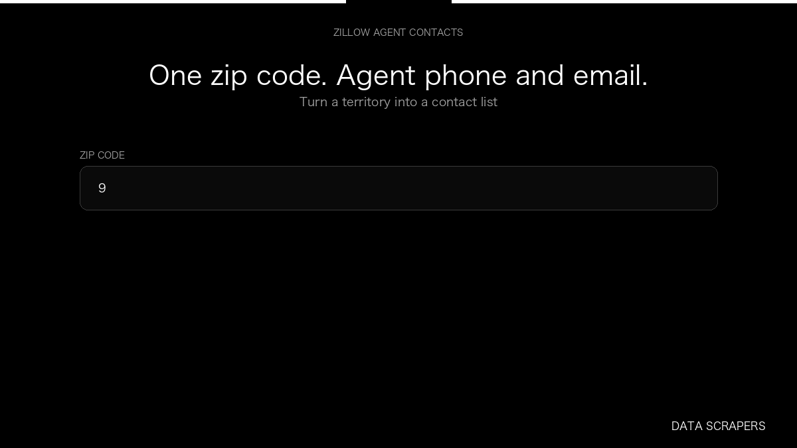

# Zillow Agents Vault

**Zillow Agents Vault** is an Apify Actor by Data Scrapers for Zillow data.

This folder hosts the public demo GIF used on the Actor README. The scraper itself runs on Apify Store — not in this repository.

**[Zillow Agents Vault on Apify](https://apify.com/datascrapers/zillow-agents-vault)**

## What this Zillow scraper does

Zillow Agents Vault returns one record per real estate agent, with phone, email, and brokerage when a detailed profile loads, for a territory contact list.

Use it as a Zillow scraper to extract structured data and export CSV, JSON, Excel, or XML from Apify.

## Start here

1. Open [Zillow Agents Vault](https://apify.com/datascrapers/zillow-agents-vault) on Apify Store.
2. Paste your Zillow URLs, queries, or other documented inputs.
3. Click **Start** and export JSON, CSV, Excel, or XML.

If you found this GitHub page while looking for a Zillow scraper, use the Apify link above to run it.
