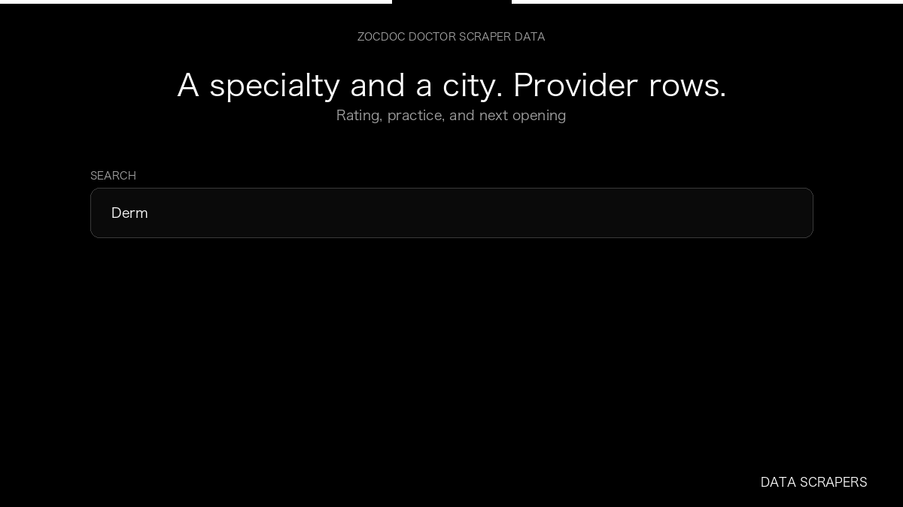

# Zocdoc Doctor Scraper

**Zocdoc Doctor Scraper** is an Apify Actor by Data Scrapers for Zocdoc data.

This folder hosts the public demo GIF used on the Actor README. The scraper itself runs on Apify Store — not in this repository.

**[Zocdoc Doctor Scraper on Apify](https://apify.com/datascrapers/zocdoc-scraper)**

## What this Zocdoc scraper does

Collect Zocdoc provider profiles from a specialty and city search.

Use it as a Zocdoc scraper to extract structured data and export CSV, JSON, Excel, or XML from Apify.

## Start here

1. Open [Zocdoc Doctor Scraper](https://apify.com/datascrapers/zocdoc-scraper) on Apify Store.
2. Paste your Zocdoc URLs, queries, or other documented inputs.
3. Click **Start** and export JSON, CSV, Excel, or XML.

If you found this GitHub page while looking for a Zocdoc scraper, use the Apify link above to run it.
